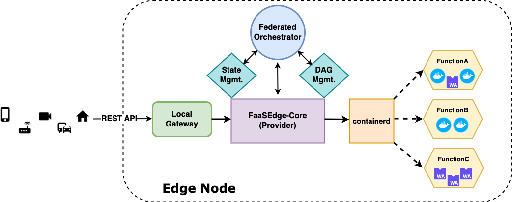

# FaaSEdge Core

Core is the execution engine for FaaSEdge. It is responsible for managing the lifecycle of process-based containers and WASM containers that run serverless functions. It is based on the [faasd provider](https://github.com/openfaas/faasd) from the [OpenFaaS](https://github.com/openfaas) project.

Similar to faasd, it relies on [containerd](https://containerd.io/) and [Container Networking Interface (CNI)](https://github.com/containernetworking/cni) for low-level container orchestration and management, but extends the original functionality to include support for different container types (e.g., WASM) and more robust function management policies (e.g., separate containers for each function invocation).




## Features

- Single container per invocation
- Recycling warm (active) and cold (inactive) container
- Background cleanup for cold containers
- Crun + WasmEdge to support WASM containers 

## Installation

### WasmEdge with WASI-NN

Configure with tensorflow lite as backend
https://wasmedge.org/book/en/contribute/build_from_src/plugin_wasi_nn.html


### Crun

clone modified crun to support WasmEdge + WASINN: https://github.com/omkarprabhu-98/crun.git
https://wasmedge.org/book/en/use_cases/kubernetes/container/crun.html


### Containerd

https://github.com/openfaas/faasd/blob/master/docs/DEV.md#get-containerd

### Fecore

```
sudo ./start.sh
```


Terminal 1
```
sudo su
cd /var/lib/fecore
fecore up
```

Terminal 2
```
sudo su
cd /var/lib/fecore-provider
secret_mount_path=/var/lib/fecore/secrets fecore provider
```

## Example Usage

Deploy a function

```
faas-cli deploy nodeinfo
```

Invoke the function
```
curl http://10.62.0.1:8081/function/nodeinfo
```

Delete the function
```
faas-cli delete nodeinfo
```

